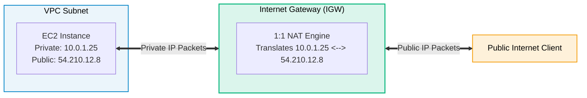

# Amazon VPC Internet Gateway (IGW)

> **Focus**: Managed horizontally scalable, highly available edge router connecting a VPC to the Internet.

---

## 1. 1:1 NAT and Bidirectional Routing

An Internet Gateway performs 1-to-1 Network Address Translation between private and public IP addresses with zero bandwidth bottlenecks.

---

## 2. Key Architectural Characteristics

- **Horizontally Scaled by AWS**: No availability constraints; scales automatically to hundreds of gigabits.
- **VPC Limit**: Exactly **one IGW** attached per VPC.
- **Stateless Router**: Simply performs address mapping and route translation.
