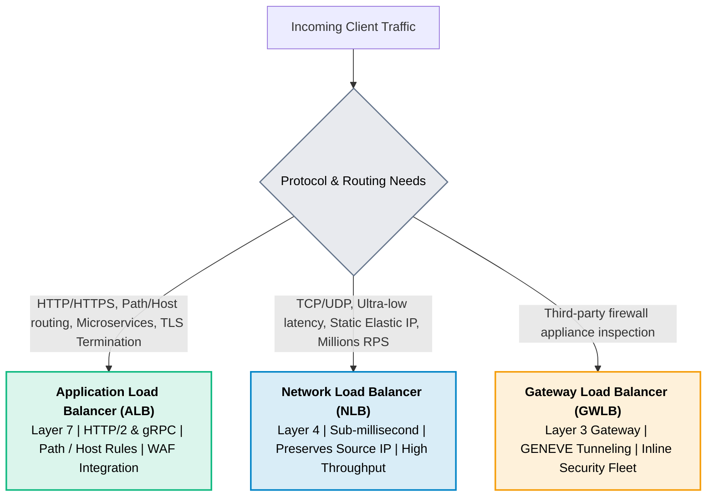
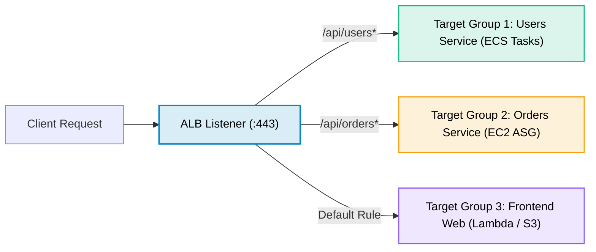

# AWS Elastic Load Balancing (ELB)

> **Focus**: Application Load Balancer (ALB), Network Load Balancer (NLB), and Gateway Load Balancer (GWLB).

---

## 1. ALB (Layer 7) vs. NLB (Layer 4)

---

## 2. ALB Path-Based Routing to Target Groups

