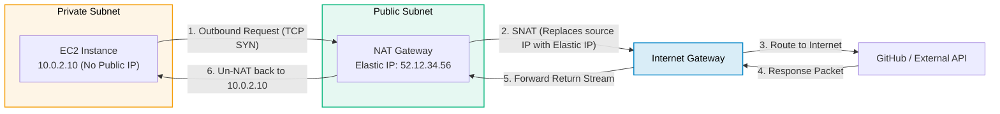
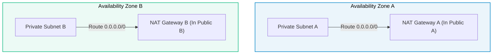

# Amazon VPC NAT Gateway

> **Focus**: Managed outbound-only internet connectivity for instances in private subnets.

---

## 1. Outbound Egress & Return Flow

---

## 2. Multi-AZ High-Availability Best Practice

> [!CAUTION] Cross-AZ NAT Anti-Pattern
> Do **not** route traffic from Private Subnet B to NAT Gateway A in another AZ. You will incur cross-AZ data transfer fees and introduce a single point of failure.
