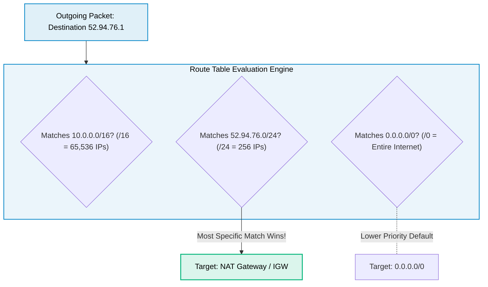
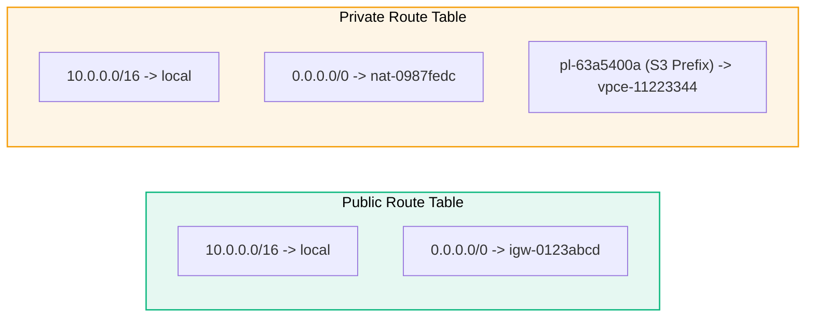

# VPC Route Tables

> **Focus**: Packet routing rules, longest-prefix-match algorithms, and gateway target associations.

---

## 1. Packet Routing Decision Engine

When a packet leaves an ENI, the VPC route table evaluates routes using **Longest Prefix Match** (most specific CIDR wins).

---

## 2. Typical Public vs Private Route Table Rules

