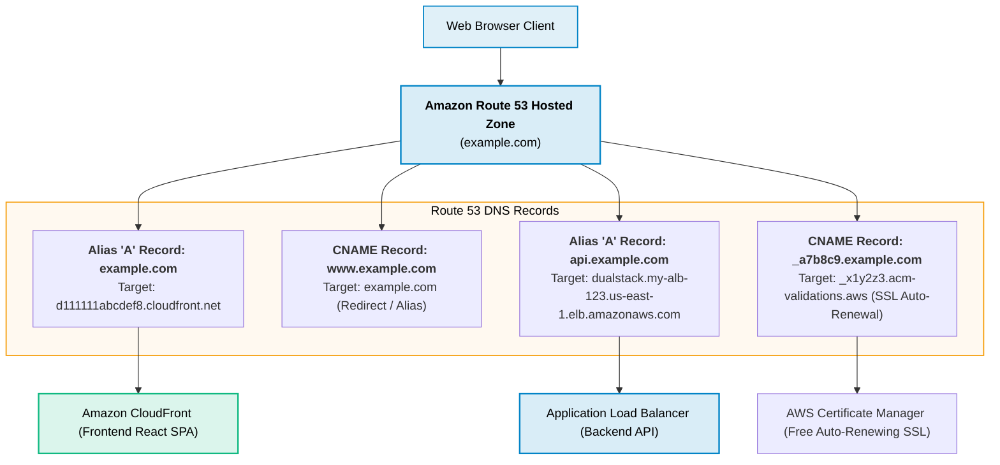
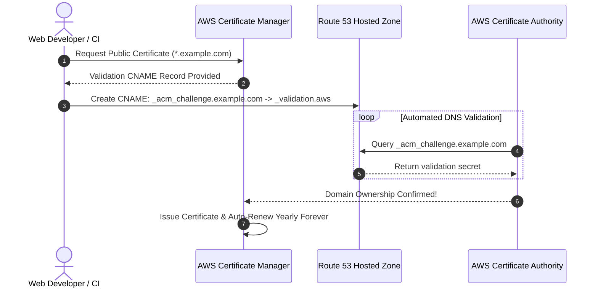
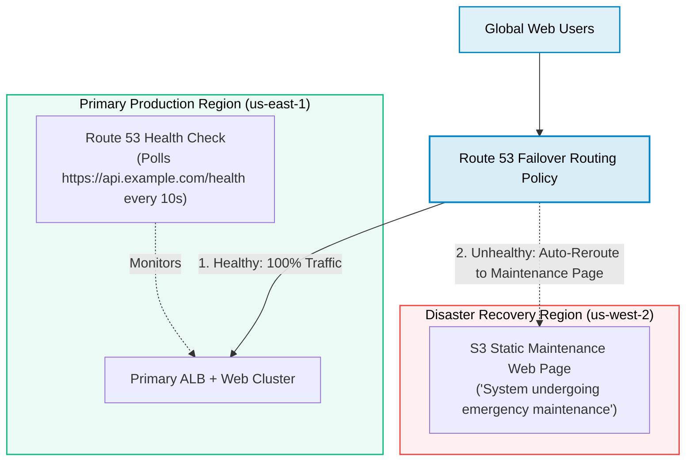

# Amazon Route 53 for Web Development

> **Focus**: Production domain routing, zone apex Alias records to CloudFront/ALB, ACM SSL validation, and multi-region failover.

---

## 1. Web Domain Resolution & Alias Routing Architecture

Standard DNS protocols forbid `CNAME` records at the root apex domain (`example.com`). Route 53 provides **Alias records**—an AWS-specific virtual DNS record that maps apex domains directly to CloudFront or ALB with zero performance penalty and free queries.

---

## 2. Automated SSL/TLS Validation with ACM & Route 53

---

## 3. Active-Passive Web Disaster Recovery (DNS Failover)

---

## 4. Web Developer DNS Cheat Sheet

| Domain Query | Record Type | Value / Routing Policy | Notes |
| :--- | :--- | :--- | :--- |
| `example.com` | **A (Alias)** | `d123.cloudfront.net` (Evaluate Target Health: Yes) | Free apex resolution |
| `www.example.com` | **CNAME** or **A (Alias)** | `example.com` | Canonical web URL |
| `api.example.com` | **A (Alias)** | ALB DNS name | Direct to API load balancer |
| `staging.example.com` | **A (Alias)** | Staging ALB / CloudFront | Test environment |
