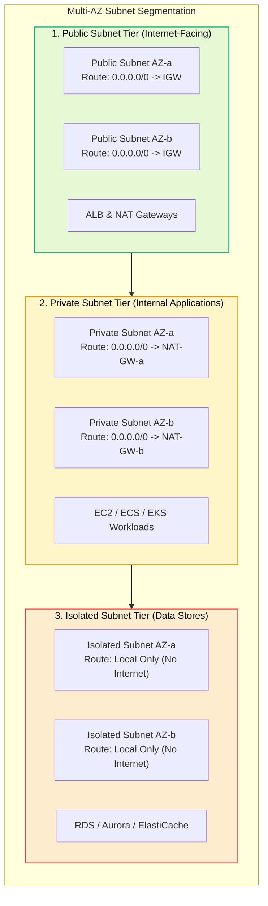

# Amazon VPC Subnets

> **Focus**: Subnet segmentation strategies: Public, Private, and Isolated tiers across AZs.

---

## 1. 3-Tier Subnet Segmentation Pattern

---

## 2. Subnet Classification Matrix

| Subnet Type | Route Table Target for `0.0.0.0/0` | Public IP Auto-Assign | Typical Resources |
| :--- | :--- | :--- | :--- |
| **Public** | `igw-xxxxxxxx` (Internet Gateway) | Yes (Optional) | ALB, NLB, NAT Gateway, Bastion |
| **Private** | `nat-xxxxxxxx` (NAT Gateway) | No | Microservices, Backend APIs, Workers |
| **Isolated** | None (Local VPC route only) | No | RDS Databases, Redis Caches, KMS HSMs |
