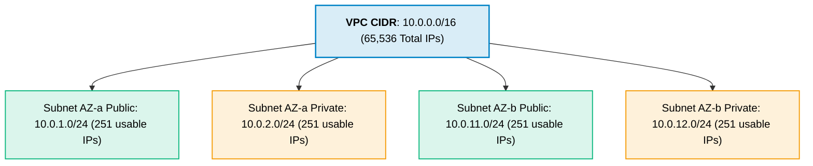
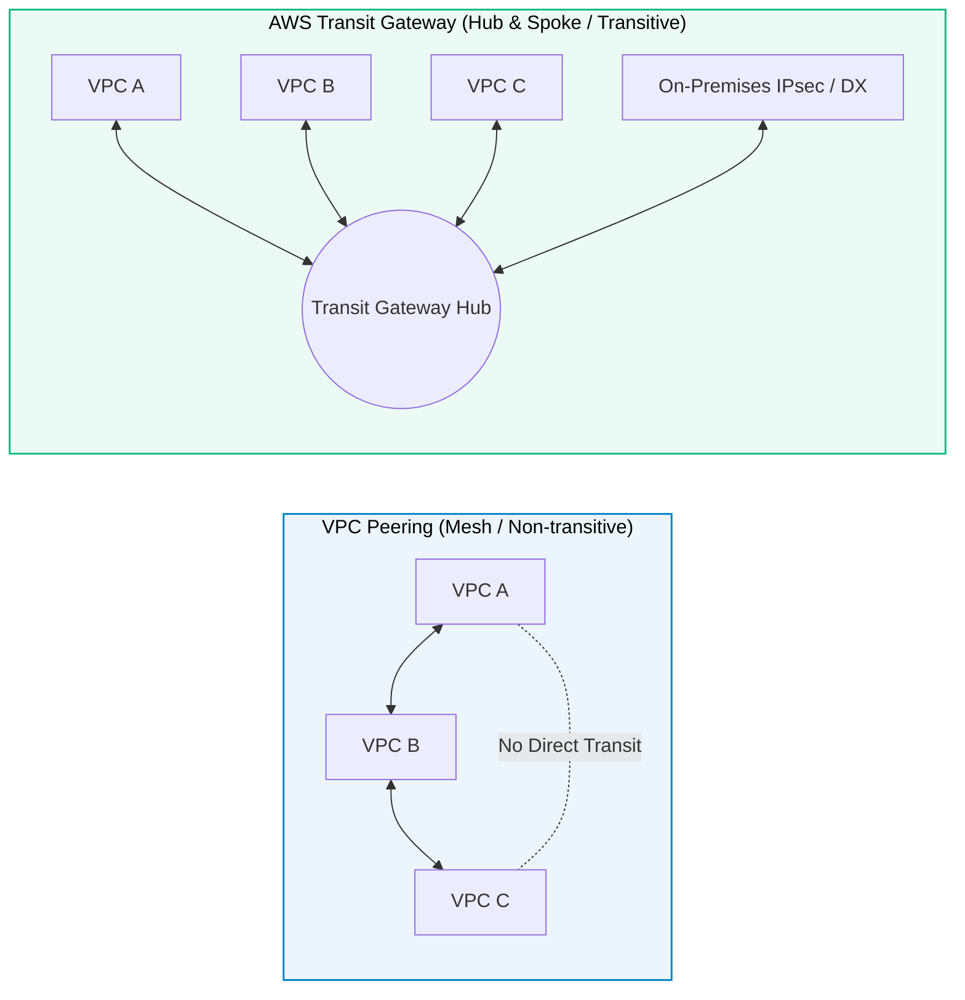

# Amazon VPC (Virtual Private Cloud)

> **Focus**: Logically isolated software-defined virtual networks, CIDR allocation, and connectivity topologies.

---

## 1. VPC CIDR & IP Addressing

> [!NOTE] AWS Reserved IP Addresses (First 4 and Last 1)
> In every subnet (e.g., `10.0.1.0/24`), 5 IPs are reserved:
> - `10.0.1.0`: Network address
> - `10.0.1.1`: VPC router
> - `10.0.1.2`: Amazon DNS server
> - `10.0.1.3`: Future AWS reservation
> - `10.0.1.255`: Network broadcast address

---

## 2. VPC Peering vs. AWS Transit Gateway

