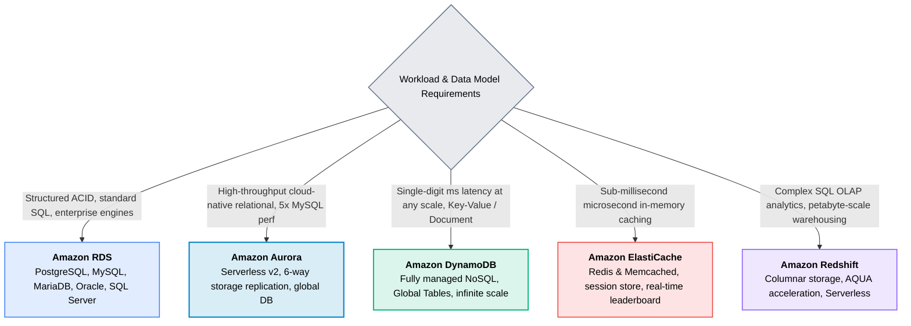

# 04 · AWS Database Services

> **Module**: Databases  
> **Focus**: Relational, Cloud-Native, NoSQL Key-Value, In-Memory Caching, and Columnar Data Warehouses.

---

## AWS Purpose-Built Database Matrix

---

## Database Directory Index

- **[[rds/README|RDS]]** — Relational Database Service, Multi-AZ automated failover, and Read Replicas.
- **[[aurora/README|Aurora]]** — Cloud-native distributed storage engine, Aurora Serverless v2, and Global Database.
- **[[dynamodb/README|DynamoDB]]** — Serverless NoSQL, Partition Keys, Global Secondary Indexes, and Streams.
- **[[elasticache/README|ElastiCache]]** — In-memory Redis/Memcached acceleration and cache-aside patterns.
- **[[redshift/README|Redshift]]** — Petabyte columnar data warehouse and RA3 managed storage.
