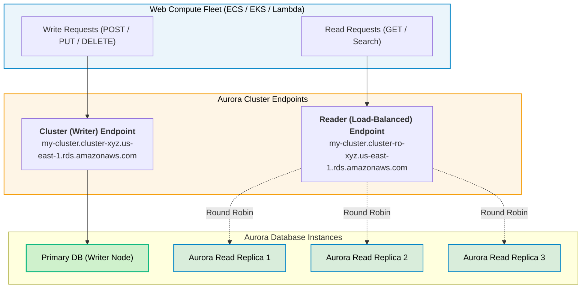
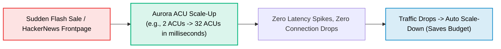

# Amazon Aurora for Web Development

> **Focus**: High-throughput relational web backends, Read Replicas for read-heavy web apps, and Aurora Serverless v2.

---

## 1. Web Application Read-Heavy Architecture (Writer vs. Reader Endpoints)

Web applications typically perform **80-90% read queries** (browsing catalogues, viewing profiles) and **10-20% write queries** (placing orders, editing settings). Aurora splits this traffic across dedicated endpoints.

---

## 2. Aurora Serverless v2 for Spikey Web Traffic

Aurora Serverless v2 scales compute capacity instantly (in fine-grained ACUs) within milliseconds without dropping active TCP connections.

