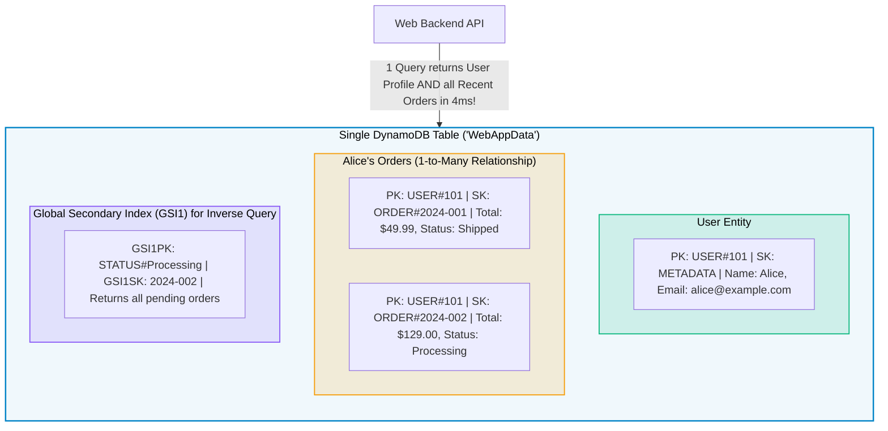
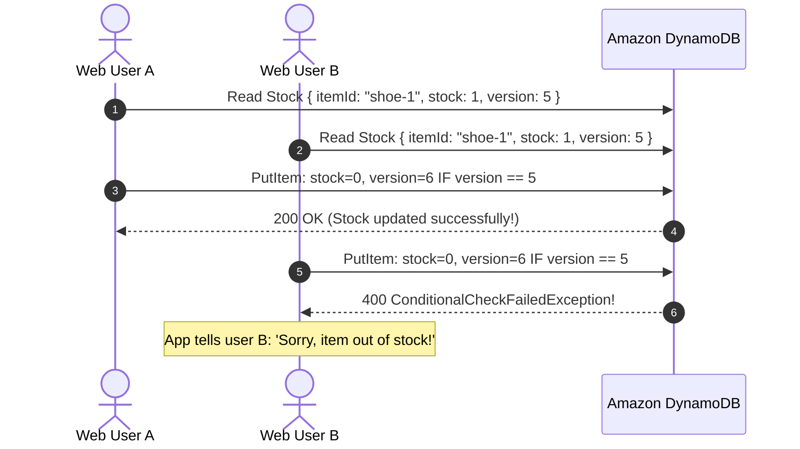

# Amazon DynamoDB for Web Development

> **Focus**: Single-Table Design for web entities, sub-10ms response times, and optimistic locking for e-commerce carts.

---

## 1. Single-Table Design for Web Applications

Instead of creating separate tables and executing expensive relational SQL `JOIN`s, modern web apps store multiple entities (Users, Orders, Products) in a **single DynamoDB table** using composite partition keys (`PK`) and sort keys (`SK`).

---

## 2. Optimistic Locking (Preventing Race Conditions)

When concurrent web requests attempt to modify the same item (e.g., deducting warehouse inventory), DynamoDB **Conditional Writes** ensure data integrity without distributed table locks.

