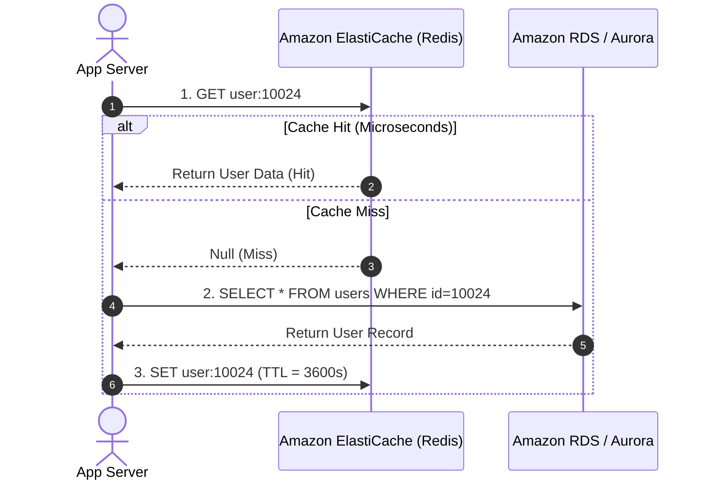
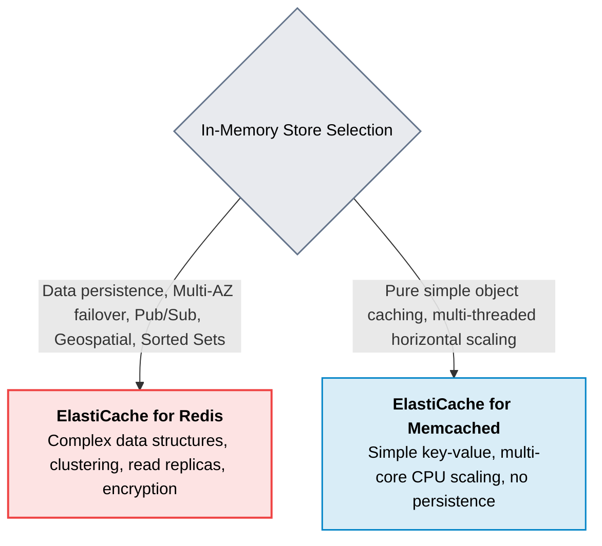

# Amazon ElastiCache

> **Focus**: In-memory data store for Redis and Memcached, sub-millisecond caching, and cache strategies.

---

## 1. Cache-Aside (Lazy Loading) Architecture Pattern

---

## 2. Redis vs. Memcached Decision Tree

