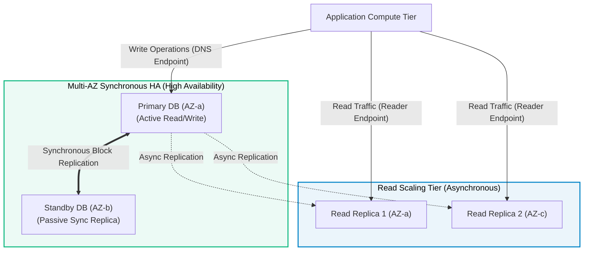

# Amazon RDS (Relational Database Service)

> **Focus**: Managed relational engines, synchronous Multi-AZ high availability, and asynchronous Read Replicas.

---

## 1. Multi-AZ Standby vs. Read Replicas

---

## 2. Multi-AZ vs. Read Replica Comparison

| Dimension | Multi-AZ Deployment | Read Replicas |
| :--- | :--- | :--- |
| **Primary Goal** | High Availability & Disaster Recovery | Read Throughput Scaling |
| **Replication Type** | Synchronous (Zero data loss) | Asynchronous (Eventual consistency) |
| **Active DB Connection**| Primary only (Standby is inactive) | All Replicas accept direct read queries |
| **Failover Action** | Automatic DNS flip to standby (60-120s)| Manual or automated promotion to primary |
| **Cross-Region** | No (Single Region across AZs) | Yes (Cross-Region replicas supported) |
