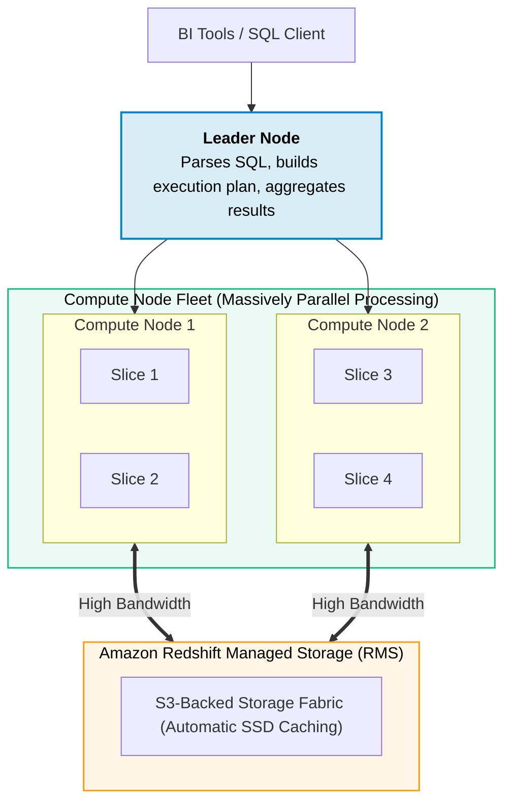
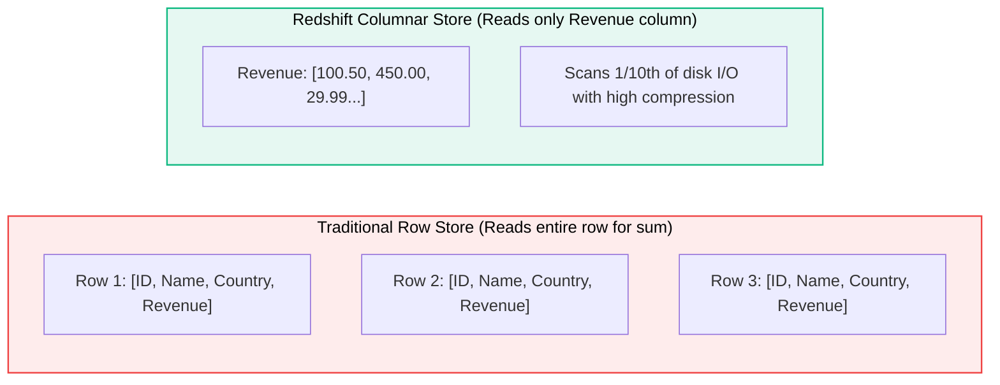

# Amazon Redshift

> **Focus**: Petabyte-scale columnar data warehouse, Massively Parallel Processing (MPP), and RA3 storage.

---

## 1. Redshift MPP Cluster Architecture

---

## 2. Row vs. Columnar Storage (Why Redshift is Fast for Analytics)

