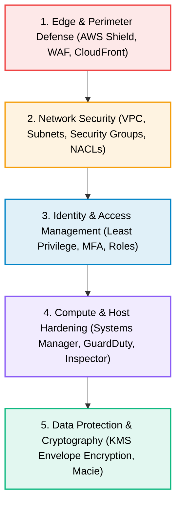

# 05 · AWS Security, Identity & Compliance

> **Module**: Security  
> **Focus**: Defense-in-depth, identity federation, cryptographic key management, secrets rotation, and perimeter firewalls.

---

## Defense-in-Depth Security Onion

---

## Security Directory Index

- **[[iam/README|IAM]]** — Identity and Access Management, policy evaluation logic, and role delegation.
- **[[kms/README|KMS]]** — Key Management Service and cryptographic envelope encryption.
- **[[secrets-manager/README|Secrets Manager]]** — Automated credential storage and Lambda lifecycle rotation.
- **[[security-groups/README|Security Groups]]** — Stateful instance-level firewalls vs. stateless NACLs.
- **[[waf/README|WAF]]** — Web Application Firewall, rule sets, and OWASP Top 10 mitigation.
