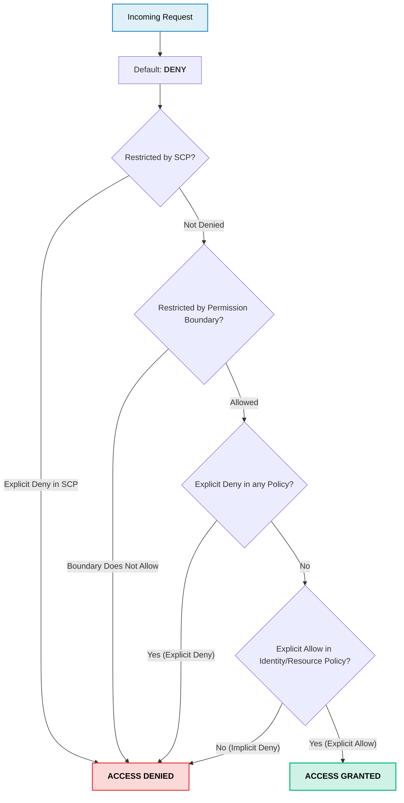
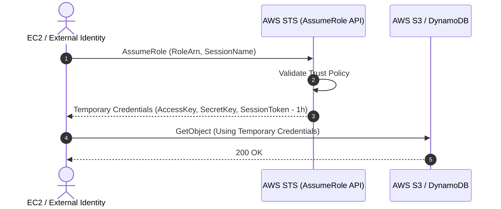

# AWS IAM (Identity & Access Management)

> **Focus**: Zero Trust identity, IAM policy evaluation flowchart, and cross-account STS role assumption.

---

## 1. IAM Policy Evaluation Logic Flowchart

Every API call made to AWS evaluates policies using deterministic order-of-operations logic.

---

## 2. STS Role Assumption (Cross-Account / Service Delegation)

