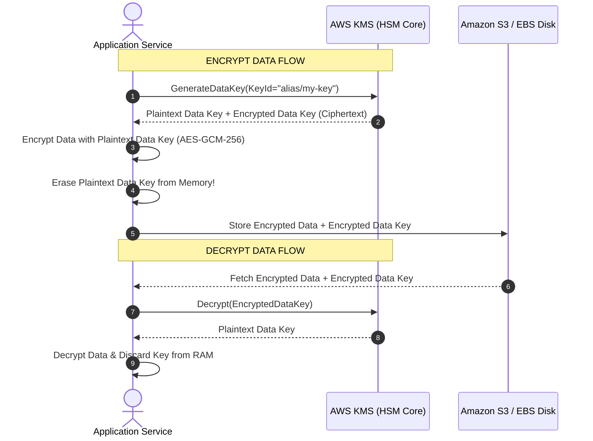

# AWS KMS (Key Management Service)

> **Focus**: Cryptographic key hierarchies, HSM-backed storage, and envelope encryption.

---

## 1. Envelope Encryption Architecture

AWS KMS uses **Envelope Encryption** to encrypt data: plaintext data is encrypted with a unique **Data Key**, and the Data Key itself is encrypted under a KMS **KMS Key (CMK)**.

---

## 2. KMS Key Types Comparison

| Key Type | Managed By | Key Rotation | Cross-Account Sharing |
| :--- | :--- | :--- | :--- |
| **AWS Owned Keys** | AWS Service | Internal AWS schedule | No (Free internal default) |
| **AWS Managed Keys** (`aws/s3`) | AWS Service for your account | Automatic every 1 year | No |
| **Customer Managed (CMK)** | Customer (Full Control) | Automatic yearly or on-demand | Yes (via Key Policies) |
