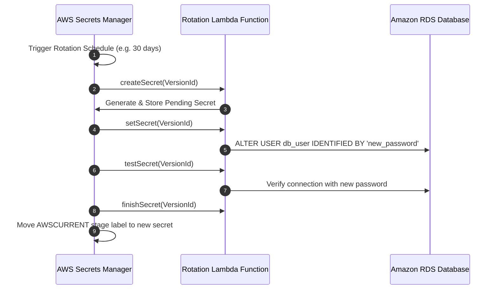
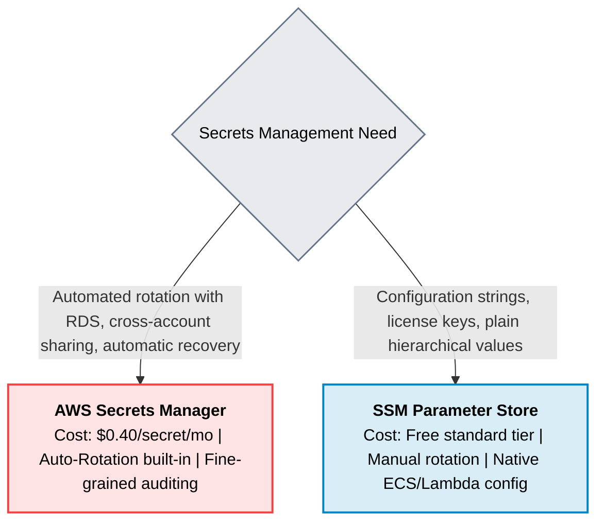

# AWS Secrets Manager

> **Focus**: Secure credential lifecycle, automated database password rotation, and audit compliance.

---

## 1. Automated Secret Rotation Architecture

---

## 2. Secrets Manager vs. SSM Parameter Store

