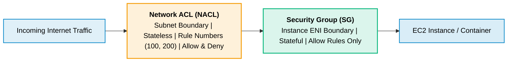
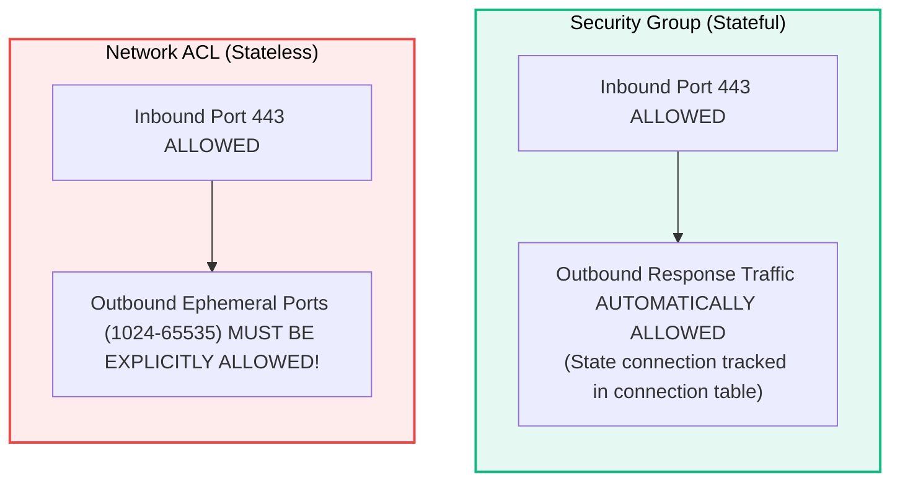

# Security Groups vs. Network ACLs (NACLs)

> **Focus**: Multi-layered network firewalls: Stateful instance ENI firewalls vs. stateless subnet boundaries.

---

## 1. Network Boundary Comparison Diagram

---

## 2. Security Group Stateful vs NACL Stateless Behavior

---

## 3. Comparison Matrix

| Property | Security Group | Network ACL (NACL) |
| :--- | :--- | :--- |
| **Operates At** | Instance / ENI level | Subnet level |
| **Rules Supported**| Allow rules only | Allow AND Deny rules |
| **State** | **Stateful** (Return traffic automatically permitted) | **Stateless** (Return traffic requires explicit rule) |
| **Rule Order** | All rules evaluated before decision | Evaluated in sequential rule order (lowest # first)|
