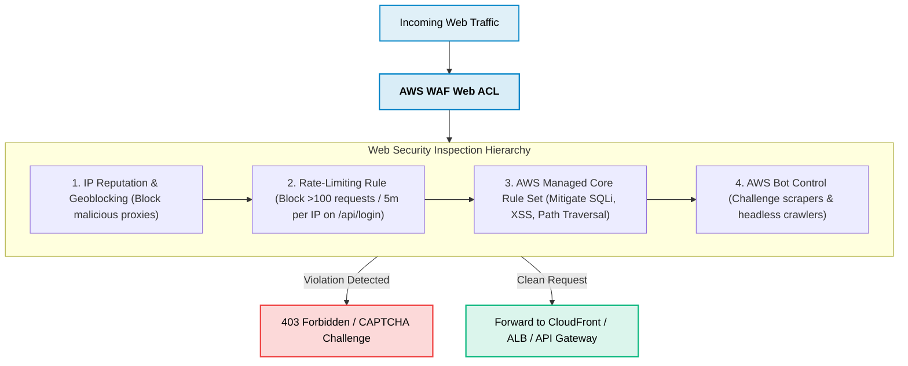

# AWS WAF for Web Development

> **Focus**: Protecting web applications against OWASP Top 10 vulnerabilities, login brute-force attacks, and scraping bots.

---

## 1. Web Application Firewall Defense Flow

AWS WAF inspects HTTP/HTTPS headers, cookies, query parameters, and JSON payloads at the edge **before** traffic reaches application servers.

---

## 2. Essential Web Developer WAF Rules

| Protection | Implementation Rule | Targeted Threat |
| :--- | :--- | :--- |
| **Login Brute-Force** | Rate-based rule: Limit to 50 requests per 5 min on URI `/api/auth/login` | Credential stuffing & password guessing |
| **SQL Injection** | `AWSManagedRulesSQLiRuleSet` | Database compromise via query tampering |
| **Cross-Site Scripting** | `AWSManagedRulesCommonRuleSet` (SizeRestrictions_BODY & CrossSiteScripting_BODY) | Malicious script execution in user browsers |
| **Scraper Bots** | AWS Bot Control Managed Rule Set | Automated price scraping & content theft |
