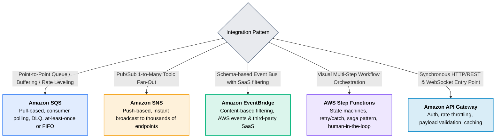

# 06 · Application Integration & Messaging

> **Module**: Integration  
> **Focus**: Decoupled asynchronous architectures, queues, pub/sub, event routing, stateful orchestration, and APIs.

---

## AWS Messaging Patterns Spectrum

---

## Integration Directory Index

- **[[sqs/README|SQS]]** — Simple Queue Service, visibility timeout, and Dead-Letter Queues.
- **[[sns/README|SNS]]** — Simple Notification Service, pub/sub topics, and fan-out topologies.
- **[[eventbridge/README|EventBridge]]** — Universal event bus, content-based pattern matching, and registry.
- **[[step-functions/README|Step Functions]]** — Serverless workflow orchestration and Saga distributed transactions.
- **[[api-gateway/README|API Gateway]]** — REST, HTTP, and WebSocket APIs with built-in governance.
- **[[bedrock/README|Bedrock]]** — Foundation model APIs, generative AI guardrails, and model invocation.
- **[[ses/README|SES]]** — Simple Email Service, transactional email delivery, and domain verification.
