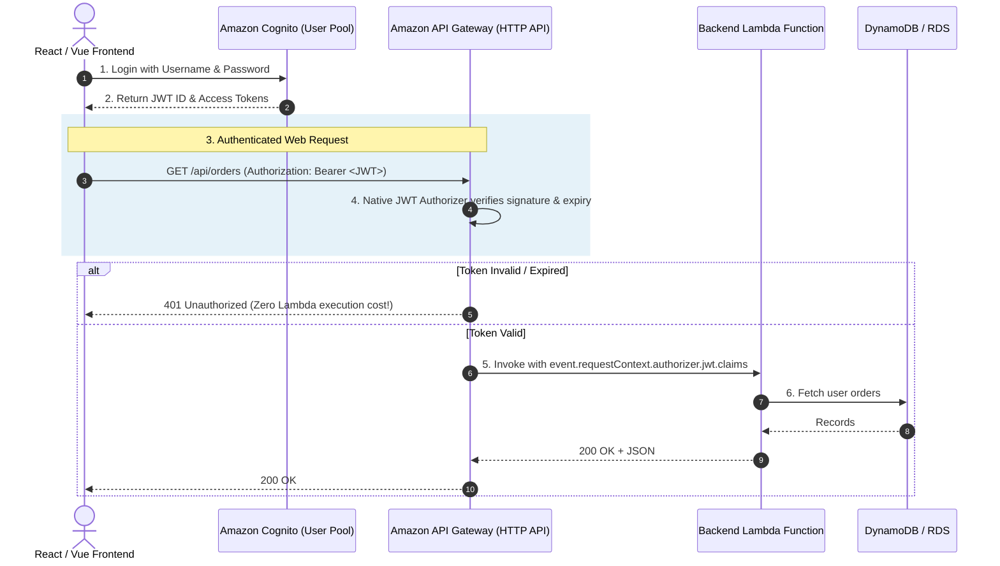
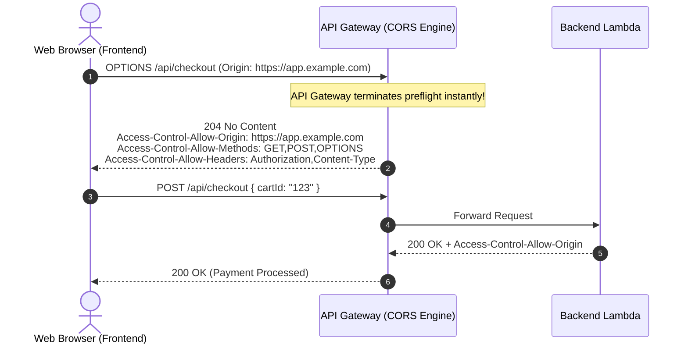
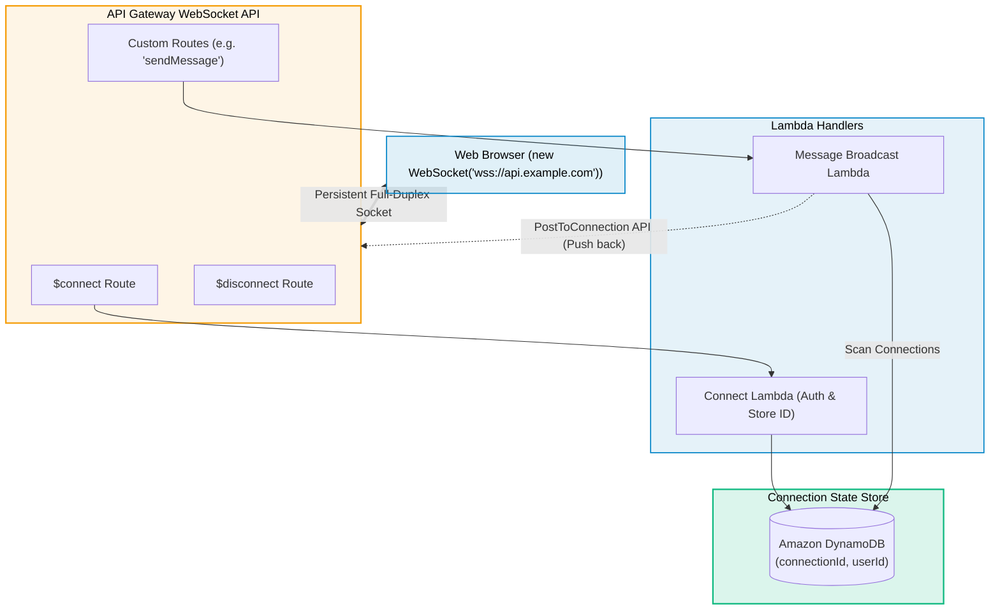

# Amazon API Gateway for Web Development

> **Focus**: REST & HTTP APIs for Single Page Applications, CORS preflight handling, Cognito/JWT authorizers, and WebSockets for real-time applications.

---

## 1. Web Application Authorization & Request Lifecycle

API Gateway validates user tokens at the edge **before** triggering any compute or database operations.

---

## 2. Cross-Origin Resource Sharing (CORS) Preflight Handling

When a frontend calls an API on a different domain, browsers automatically dispatch an `OPTIONS` preflight request.

---

## 3. Real-Time WebSockets for Live Web Chat & Notifications

Unlike standard stateless HTTP, API Gateway WebSocket APIs maintain persistent, bi-directional connections to thousands of browser clients.

---

## 4. HTTP API vs. REST API for Web Developers

| Feature | HTTP API (Recommended for Web) | REST API |
| :--- | :--- | :--- |
| **Cost** | **$1.00** per million requests | **$3.50** per million requests |
| **Latency** | Sub-10ms (Optimized engine) | ~30-50ms |
| **Native JWT / OIDC** | Built-in (Cognito, Auth0, Okta) | Requires custom Lambda Authorizer |
| **CORS Configuration**| 1-Click native configuration | Requires Mock Integration setup |
| **Advanced Features** | No WAF, no API keys, no cache | WAF, API Keys, Usage Plans, Request Validation |
