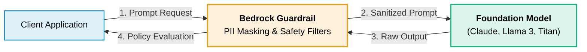

# Amazon Bedrock

> **Focus**: Fully managed Foundation Model (FM) APIs, generative AI guardrails, model invocation, and serverless AI application integration.

---

## 1. Bedrock Architecture & Guardrails Workflow



---

## 2. Infrastructure as Code & SDK Implementations

### CDK (TypeScript)

```typescript
import * as cdk from 'aws-cdk-lib';
import * as bedrock from 'aws-cdk-lib/aws-bedrock';
import { Construct } from 'constructs';

export class BedrockStack extends cdk.Stack {
  constructor(scope: Construct, id: string, props?: cdk.StackProps) {
    super(scope, id, props);

    new bedrock.CfnGuardrail(this, 'EnterpriseGuardrail', {
      name: 'enterprise-content-policy',
      blockedInputMessaging: 'Input violates enterprise safety guidelines.',
      blockedOutputsMessaging: 'Output blocked by compliance policy.',
      contentPolicyConfig: {
        filtersConfig: [
          { type: 'HATE', inputStrength: 'HIGH', outputStrength: 'HIGH' },
          { type: 'VIOLENCE', inputStrength: 'HIGH', outputStrength: 'HIGH' },
          { type: 'SEXUAL', inputStrength: 'HIGH', outputStrength: 'HIGH' },
          { type: 'INSULTS', inputStrength: 'HIGH', outputStrength: 'HIGH' },
        ],
      },
    });
  }
}
```

### CDK (Python)

```python
import aws_cdk as cdk
from aws_cdk import aws_bedrock as bedrock
from constructs import Construct

class BedrockStack(cdk.Stack):
    def __init__(self, scope: Construct, construct_id: str, **kwargs) -> None:
        super().__init__(scope, construct_id, **kwargs)

        bedrock.CfnGuardrail(
            self, "EnterpriseGuardrail",
            name="enterprise-content-policy",
            blocked_input_messaging="Input violates enterprise safety guidelines.",
            blocked_outputs_messaging="Output blocked by compliance policy.",
            content_policy_config=bedrock.CfnGuardrail.ContentPolicyConfigProperty(
                filters_config=[
                    bedrock.CfnGuardrail.ContentFilterConfigProperty(
                        type="HATE", input_strength="HIGH", output_strength="HIGH"
                    ),
                    bedrock.CfnGuardrail.ContentFilterConfigProperty(
                        type="VIOLENCE", input_strength="HIGH", output_strength="HIGH"
                    ),
                    bedrock.CfnGuardrail.ContentFilterConfigProperty(
                        type="SEXUAL", input_strength="HIGH", output_strength="HIGH"
                    ),
                    bedrock.CfnGuardrail.ContentFilterConfigProperty(
                        type="INSULTS", input_strength="HIGH", output_strength="HIGH"
                    )
                ]
            )
        )
```

### YAML (CloudFormation)

```yaml
AWSTemplateFormatVersion: '2010-09-09'
Description: Amazon Bedrock Content Guardrail Stack

Resources:
  BedrockSafetyGuardrail:
    Type: AWS::Bedrock::Guardrail
    Properties:
      Name: enterprise-content-policy
      BlockedInputMessaging: Input violates enterprise safety guidelines.
      BlockedOutputsMessaging: Output blocked by compliance policy.
      ContentPolicyConfig:
        FiltersConfig:
          - Type: HATE
            InputStrength: HIGH
            OutputStrength: HIGH
          - Type: VIOLENCE
            InputStrength: HIGH
            OutputStrength: HIGH
          - Type: SEXUAL
            InputStrength: HIGH
            OutputStrength: HIGH
          - Type: INSULTS
            InputStrength: HIGH
            OutputStrength: HIGH
```

### SDK (TypeScript)

```typescript
import { BedrockRuntimeClient, InvokeModelCommand } from '@aws-sdk/client-bedrock-runtime';

const client = new BedrockRuntimeClient({ region: 'us-east-1' });

async function invokeBedrockModel() {
  const requestBody = {
    anthropic_version: 'bedrock-2023-05-31',
    max_tokens: 300,
    messages: [
      { role: 'user', content: 'Summarize the core benefits of cloud service models.' },
    ],
  };

  const command = new InvokeModelCommand({
    modelId: 'anthropic.claude-3-haiku-20240307-v1:0',
    contentType: 'application/json',
    accept: 'application/json',
    body: Buffer.from(JSON.stringify(requestBody)),
  });

  const response = await client.send(command);
  const result = JSON.parse(Buffer.from(response.body).toString('utf-8'));
  console.log('AI Response:', result.content[0].text);
}

invokeBedrockModel();
```

### SDK (Python)

```python
import json
import boto3

bedrock_client = boto3.client('bedrock-runtime', region_name='us-east-1')

def invoke_bedrock_model():
    request_body = {
        "anthropic_version": "bedrock-2023-05-31",
        "max_tokens": 300,
        "messages": [
            {"role": "user", "content": "Summarize the core benefits of cloud service models."}
        ]
    }

    response = bedrock_client.invoke_model(
        modelId='anthropic.claude-3-haiku-20240307-v1:0',
        contentType='application/json',
        accept='application/json',
        body=json.dumps(request_body)
    )

    result = json.loads(response['body'].read().decode('utf-8'))
    print("AI Response:", result['content'][0]['text'])

invoke_bedrock_model()
```
