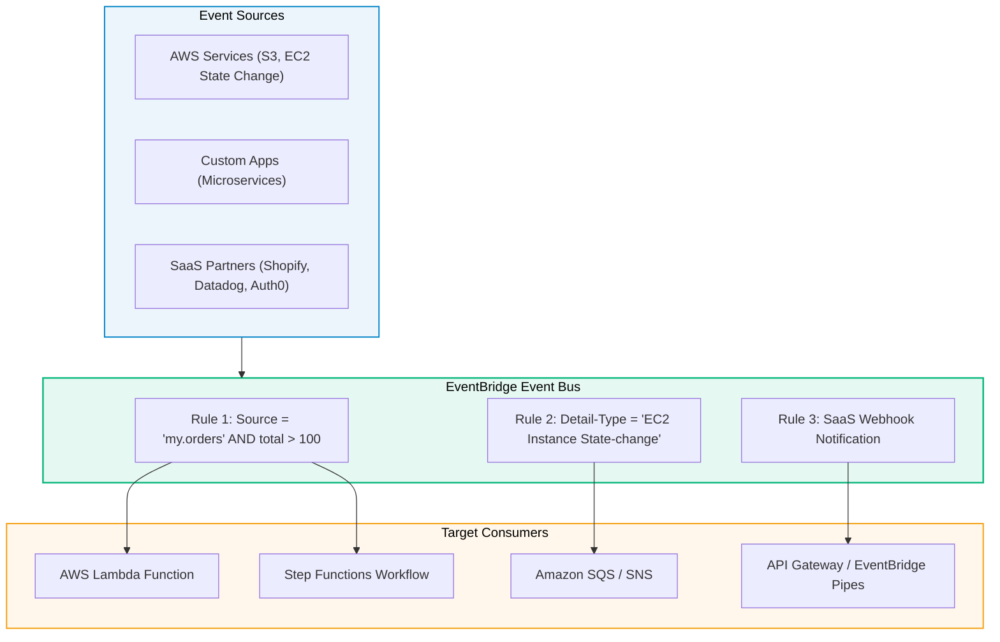

# Amazon EventBridge (Serverless Event Bus)

> **Focus**: Content-based JSON event routing, SaaS partner integration, and scheduled rules.

---

## 1. Event Routing Pipeline

---

## 2. EventBridge vs. SNS Comparison

| Feature | Amazon EventBridge | Amazon SNS |
| :--- | :--- | :--- |
| **Payload Filtering**| Inspects full JSON payload contents & arrays | Inspects message attributes only |
| **Latency** | Typical ~50ms | Ultra-low (sub-10ms) |
| **Third-Party SaaS** | Native Partner Event Source connectors | Requires custom webhook receiver |
| **Schema Registry** | Automatic schema discovery & code binding | No built-in schema registry |
