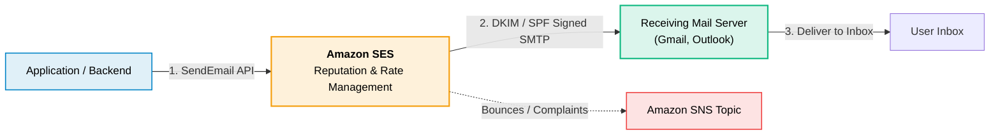

# Amazon SES (Simple Email Service)

> **Focus**: Managed transactional email delivery, domain identity validation (DKIM/SPF), bounce handling, and email API integration.

---

## 1. SES Domain Verification & Email Flow



---

## 2. Infrastructure as Code & SDK Implementations

### CDK (TypeScript)

```typescript
import * as cdk from 'aws-cdk-lib';
import * as ses from 'aws-cdk-lib/aws-ses';
import { Construct } from 'constructs';

export class SesStack extends cdk.Stack {
  constructor(scope: Construct, id: string, props?: cdk.StackProps) {
    super(scope, id, props);

    new ses.EmailIdentity(this, 'CompanyDomain', {
      identity: ses.Identity.domain('example.com'),
    });
  }
}
```

### CDK (Python)

```python
import aws_cdk as cdk
from aws_cdk import aws_ses as ses
from constructs import Construct

class SesStack(cdk.Stack):
    def __init__(self, scope: Construct, construct_id: str, **kwargs) -> None:
        super().__init__(scope, construct_id, **kwargs)

        ses.EmailIdentity(
            self, "CompanyDomain",
            identity=ses.Identity.domain("example.com")
        )
```

### YAML (CloudFormation)

```yaml
AWSTemplateFormatVersion: '2010-09-09'
Description: Amazon SES Email Identity

Resources:
  SESDomainIdentity:
    Type: AWS::SES::EmailIdentity
    Properties:
      EmailIdentity: example.com
```

### SDK (TypeScript)

```typescript
import { SESClient, SendEmailCommand } from '@aws-sdk/client-ses';

const client = new SESClient({ region: 'us-east-1' });

async function sendNotificationEmail() {
  const command = new SendEmailCommand({
    Source: 'no-reply@example.com',
    Destination: { ToAddresses: ['user@example.com'] },
    Message: {
      Subject: { Data: 'Order Confirmation' },
      Body: { Text: { Data: 'Your order was successfully placed.' } },
    },
  });

  const response = await client.send(command);
  console.log('Message ID:', response.MessageId);
}

sendNotificationEmail();
```

### SDK (Python)

```python
import boto3

ses_client = boto3.client('ses', region_name='us-east-1')

def send_notification_email():
    response = ses_client.send_email(
        Source='no-reply@example.com',
        Destination={'ToAddresses': ['user@example.com']},
        Message={
            'Subject': {'Data': 'Order Confirmation'},
            'Body': {'Text': {'Data': 'Your order was successfully placed.'}}
        }
    )
    print("Message ID:", response['MessageId'])

send_notification_email()
```
