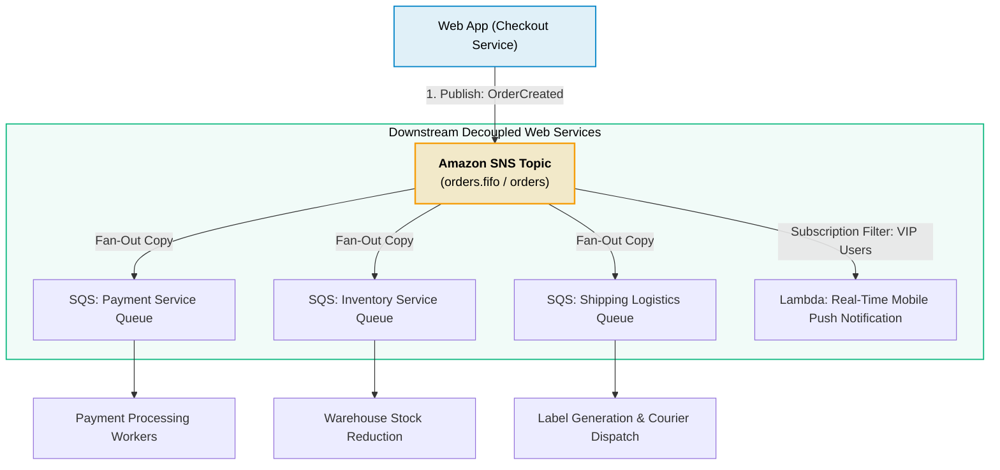
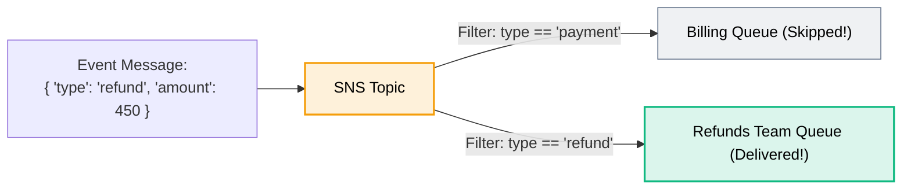

# Amazon SNS for Web Development

> **Focus**: Pub/Sub event broadcasting, fan-out architecture, transactional customer notifications (SMS/Email), and message filtering.

---

## 1. Web Application Event Fan-Out Architecture

When a business event occurs (e.g., `UserCheckoutCompleted`), the web application publishes a single message to an SNS topic. Downstream services consume independent copies via SQS queues without tight coupling.

---

## 2. Subscription Filter Policies (Smart Routing)

Instead of writing custom code in consumers to discard irrelevant messages, SNS subscription filter policies filter events at the SNS infrastructure tier.

---

## 3. Transactional Customer Communication (SMS & Email)

- **Direct SMS Dispatch**: Instant one-time passwords (OTP) and two-factor authentication codes delivered globally.
- **Delivery Status Logging**: Tracks whether SMS/Email carrier gateways successfully delivered notifications to users.
