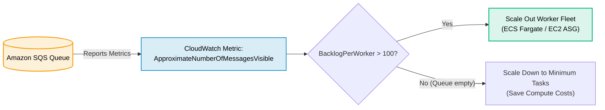
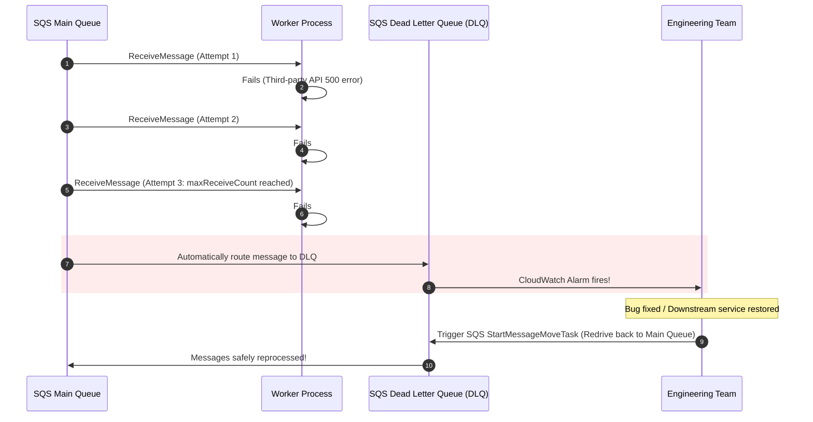

# Amazon SQS for Web Development

> **Focus**: Decoupling slow web operations, asynchronous background workers, consumer autoscaling by backlog, and Dead Letter Queues (DLQ).

---

## 1. Web Request Decoupling: Synchronous API vs. SQS Worker

Web servers must reply to users within `< 200 milliseconds`. Heavy operations (sending verification emails, generating PDFs, processing billing) should be offloaded to an asynchronous SQS queue.

```mermaid
flowchart TD
    subgraph SYNC["Synchronous Anti-Pattern (Slow & Fragile)"]
        direction LR
        S_USER["User"] -->|POST /order| S_API["Web Server"]
        S_API --> S_EMAIL["Send Email (3s)"]
        S_EMAIL --> S_PDF["Generate Invoice (5s)"]
        S_PDF --> S_PAY["Process Payment (2s)"]
        S_PAY -->>|Total: 10s Latency!| S_USER
    end

    subgraph ASYNC["Decoupled Asynchronous Pattern (Fast & Resilient)"]
        direction LR
        A_USER["User"] -->|POST /order| A_API["Web Server"]
        A_API -->|1. Enqueue Message| QUEUE[("<b>Amazon SQS</b>")]
        A_API -->>|"2. Immediate 202 Accepted (50ms)"| A_USER
        QUEUE --> WORKER["Background Worker Pool<br/>(Processes Email, PDF, Payment in Background)"]
    end

    style SYNC fill:#ef4444,fill-opacity:0.08,stroke:#ef4444,stroke-width:1.5px,color:inherit
    style ASYNC fill:#10b981,fill-opacity:0.08,stroke:#10b981,stroke-width:2px,color:inherit
```

---

## 2. Queue Backlog Autoscaling Loop (Target Tracking)

Instead of scaling workers on CPU, web worker fleets scale based on the queue depth metric: **`BacklogPerWorker = ApproximateNumberOfMessagesVisible / NumberOfWorkers`**.



---

## 3. Dead Letter Queue (DLQ) & Automated Redrive

When bad payloads or downstream API outages cause processing failures, messages move to a DLQ without blocking other valid web orders.


