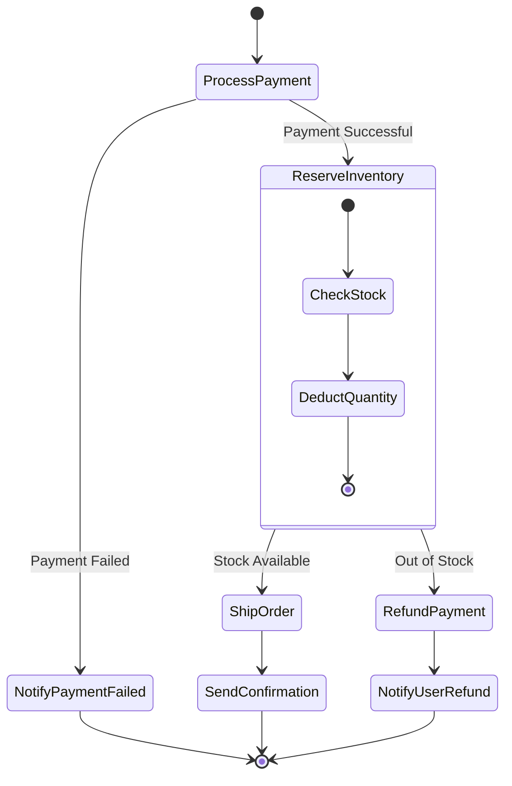

# AWS Step Functions

> **Focus**: Visual state machine orchestration, error handling, parallel execution, and Saga patterns.

---

## 1. Order Processing State Machine

---

## 2. Standard vs. Express Workflows

| Characteristic | Standard Workflows | Express Workflows |
| :--- | :--- | :--- |
| **Execution Duration**| Up to **1 year** | Up to **5 minutes** |
| **Execution Rate** | Up to 2,000 / sec | Over 100,000 / sec |
| **Pricing Model** | Per state transition ($0.025 / 1k) | Execution duration & memory consumed |
| **Execution Semantics**| Exactly-once execution | At-least-once (or at-most-once) |
| **Use Cases** | Order fulfillment, ETL orchestration | High-volume IoT ingestion, streaming APIs |
