# 07 · AWS DevOps & Infrastructure as Code

> **Module**: DevOps  
> **Focus**: Infrastructure as Code (IaC), continuous integration and continuous deployment (CI/CD) pipelines.

---

## AWS CI/CD Pipeline Blueprint

```mermaid
flowchart LR
    DEV["Developer Push<br/>(Git Commit)"] --> SRC["<b>AWS CodeCommit / GitHub</b><br/>Source Trigger"]
    SRC --> BLD["<b>AWS CodeBuild</b><br/>Unit Tests, Docker Build, Security Scan"]
    BLD --> ARTIFACT["Amazon S3 / ECR<br/>Artifact Store"]
    ARTIFACT --> PIPE["<b>AWS CodePipeline</b><br/>Multi-Stage Orchestration"]
    
    PIPE --> STG["Deploy to Staging<br/>(CloudFormation / CDK)"]
    STG --> APPR{"Manual Approval"}
    APPR -->|Approved| PROD["Deploy to Production<br/>(Canary / Blue-Green)"]

    style DEV fill:#0284c7,fill-opacity:0.12,stroke:#0284c7,stroke-width:1.5px,color:inherit
    style SRC fill:#0284c7,fill-opacity:0.1,stroke:#0284c7,stroke-width:1.5px,color:inherit
    style BLD fill:#f59e0b,fill-opacity:0.15,stroke:#f59e0b,stroke-width:1.5px,color:inherit
    style PIPE fill:#10b981,fill-opacity:0.15,stroke:#10b981,stroke-width:2px,color:inherit
    style PROD fill:#8b5cf6,fill-opacity:0.15,stroke:#8b5cf6,stroke-width:2px,color:inherit
```

---

## DevOps Directory Index

- **[[cdk/README|CDK]]** — Cloud Development Kit, construct levels (L1, L2, L3), and synthesis.
- **[[cloudformation/README|CloudFormation]]** — Declarative JSON/YAML stacks, drift detection, and Change Sets.
- **[[codepipeline/README|CodePipeline]]** — Multi-stage deployment pipelines and gating.
- **[[codebuild/README|CodeBuild]]** — Containerized elastic build and test runners.
