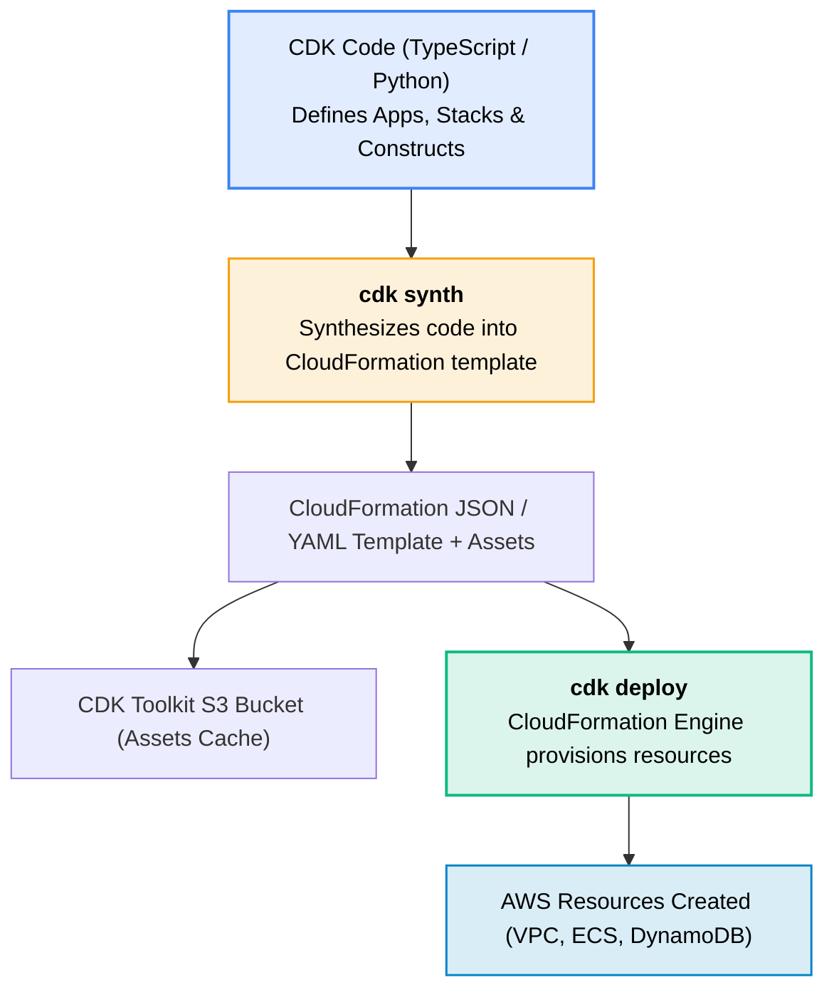
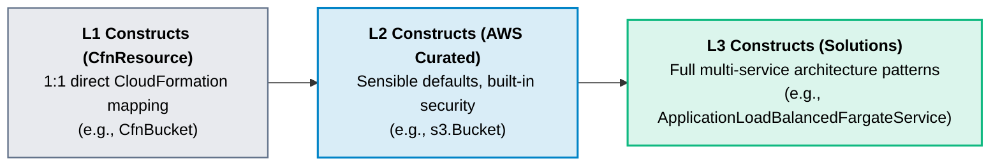

# AWS Cloud Development Kit (CDK)

> **Focus**: Defining cloud infrastructure using familiar programming languages (TypeScript, Python, Go).

---

## 1. CDK Synthesis & Deployment Pipeline

---

## 2. CDK Construct Abstraction Levels

