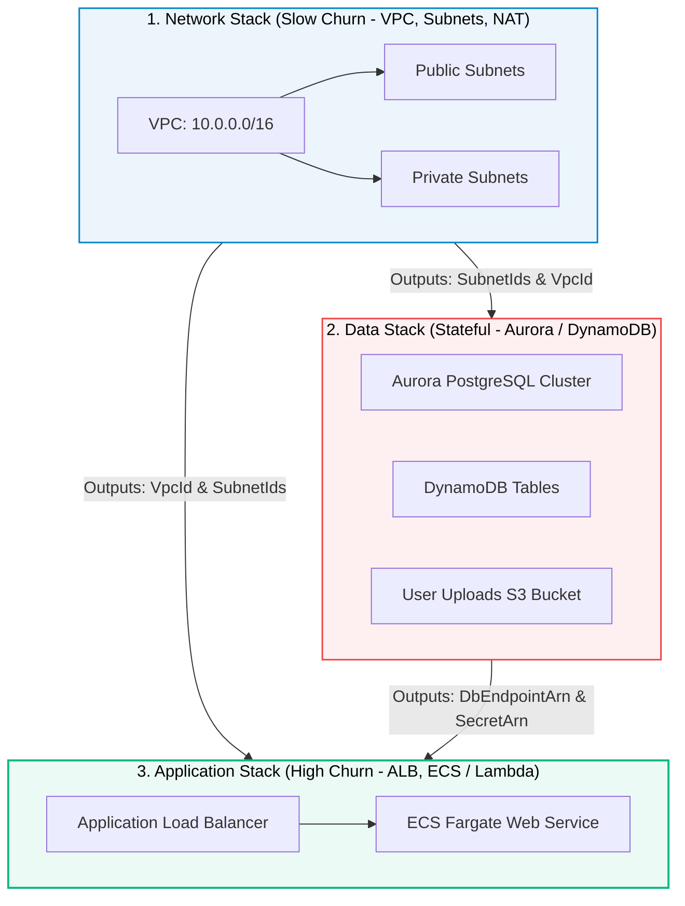
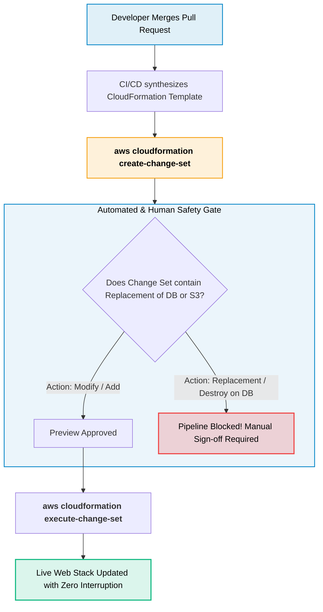

# AWS CloudFormation for Web Development

> **Focus**: Modular Infrastructure as Code (IaC), cross-stack references (`Fn::ImportValue`), Change Sets for safe releases, and protecting stateful databases.

---

## 1. Modular Multi-Stack Architecture for Web Applications

Enterprise web projects avoid giant monolithic templates by decomposing infrastructure into lifecycle-based stacks:



---

## 2. Safe Deployment Workflow: Change Sets & Drift Detection

Never execute in-place updates blindly. CloudFormation Change Sets allow developers to preview the blast radius before executing changes.



---

## 3. Web Stack CloudFormation Template Anatomy

```yaml
AWSTemplateFormatVersion: '2010-09-09'
Description: 'Production Web API Stack'

Parameters:
  Environment:
    Type: String
    Default: production
    AllowedValues: [staging, production]
  ContainerImage:
    Type: String
    Description: 'ECR Image URI with Git SHA tag'

Resources:
  # Application Load Balancer
  ApplicationLoadBalancer:
    Type: AWS::ElasticLoadBalancingV2::LoadBalancer
    Properties:
      Scheme: internet-facing
      Subnets: !Split [',', !ImportValue 'NetworkStack-PublicSubnets']
      SecurityGroups: [!Ref AlbSecurityGroup]

  # ECS Web Service
  WebService:
    Type: AWS::ECS::Service
    Properties:
      Cluster: !ImportValue 'NetworkStack-EcsCluster'
      LaunchType: FARGATE
      DesiredCount: 3
      TaskDefinition: !Ref WebTaskDefinition
      LoadBalancers:
        - ContainerName: 'web-api'
          ContainerPort: 8080
          TargetGroupArn: !Ref WebTargetGroup

Outputs:
  AlbDnsName:
    Description: 'Public URL for Route 53'
    Value: !GetAtt ApplicationLoadBalancer.DNSName
    Export:
      Name: !Sub '${AWS::StackName}-AlbDns'
```
