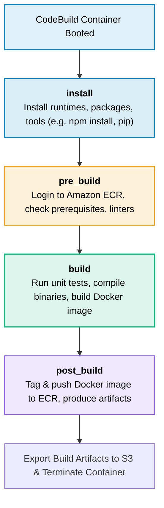

# AWS CodeBuild

> **Focus**: Serverless build and continuous integration service, custom Docker runtimes, and buildspec lifecycle.

---

## 1. Build Lifecycle Phases (`buildspec.yml`)

---

## 2. Key Operational Features

- **Elastic Scaling**: Spawns parallel dedicated containers per build; zero build queue contention.
- **Pay-Per-Minute**: Billed only for compute duration consumed during build phases.
