# AWS CodePipeline

> **Focus**: Continuous delivery orchestration, automated stage gates, and multi-environment promotions.

---

## 1. Multi-Stage Pipeline Flow

```mermaid
flowchart LR
    subgraph S1["Stage 1: Source"]
        SRC["GitHub / CodeCommit / S3"]
    end

    subgraph S2["Stage 2: Build & Test"]
        BLD["AWS CodeBuild<br/>Compile, Lint, Unit Test"]
    end

    subgraph S3["Stage 3: Staging Deploy"]
        DEPLOY_STG["CloudFormation Deploy<br/>(Staging Account)"]
    end

    subgraph S4["Stage 4: Quality Gate"]
        GATE["Manual Approval / Automated Integration Tests"]
    end

    subgraph S5["Stage 5: Production Deploy"]
        DEPLOY_PROD["Canary Traffic Shift<br/>(Production Account)"]
    end

    S1 --> S2 --> S3 --> S4 --> S5

    style S1 fill:#0284c7,fill-opacity:0.1,stroke:#0284c7,stroke-width:1.5px,color:inherit
    style S2 fill:#f59e0b,fill-opacity:0.1,stroke:#f59e0b,stroke-width:1.5px,color:inherit
    style S3 fill:#10b981,fill-opacity:0.1,stroke:#10b981,stroke-width:1.5px,color:inherit
    style S4 fill:#8b5cf6,fill-opacity:0.1,stroke:#8b5cf6,stroke-width:1.5px,color:inherit
    style S5 fill:#ef4444,fill-opacity:0.1,stroke:#ef4444,stroke-width:1.5px,color:inherit
```

---

## 2. Artifact Transitions Between Stages

Each pipeline stage pulls input artifacts from an S3 bucket and publishes output artifacts for downstream stages.
