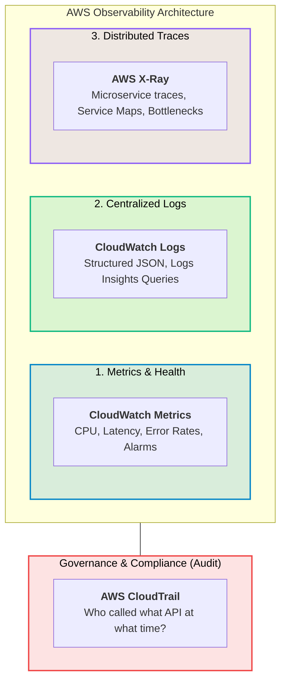

# 08 · AWS Observability & Monitoring

> **Module**: Monitoring  
> **Focus**: The three pillars of observability: Metrics & Alarms, Centralized Logs, and Distributed Tracing.

---

## Observability Triad on AWS

---

## Monitoring Directory Index

- **[[cloudwatch/README|CloudWatch]]** — Metrics, dynamic alarms, Logs Insights, and dashboards.
- **[[cloudtrail/README|CloudTrail]]** — API activity logging, governance auditing, and trail integrity.
- **[[x-ray/README|X-Ray]]** — Distributed transaction tracing, service latency maps, and subsegment analysis.
