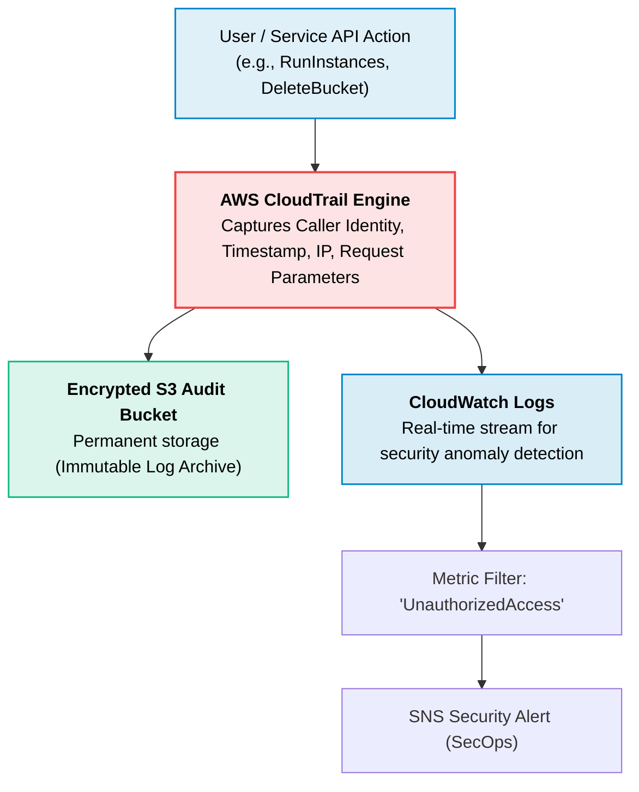

# AWS CloudTrail

> **Focus**: Comprehensive API auditing, security forensic investigation, and compliance tracking.

---

## 1. CloudTrail Event Delivery Pipeline

CloudTrail records every API call made in the AWS account (Console, CLI, SDK, and service-to-service).

---

## 2. Event Types Reference

| Event Category | Scope | Examples | Default Enabled |
| :--- | :--- | :--- | :--- |
| **Management Events** | Control plane actions on resources | `CreateBucket`, `TerminateInstances`, `AttachPolicy` | Yes (90-day free event history) |
| **Data Events** | High-volume data plane actions | `S3:GetObject`, `DynamoDB:PutItem`, `Lambda:Invoke` | No (Opt-in per resource) |
| **Insights Events** | Anomaly detection for unusual API call spikes | Sudden spike in IAM write calls | No (Opt-in) |
