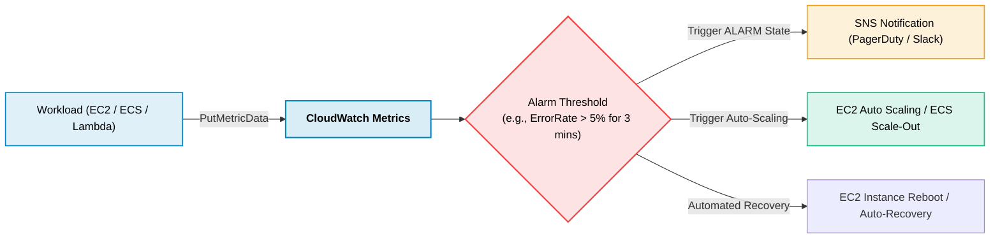
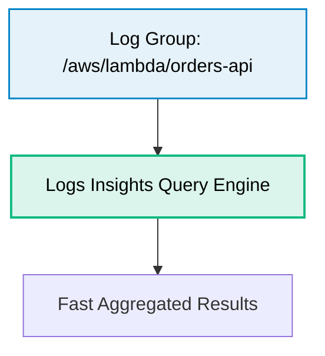

# Amazon CloudWatch

> **Focus**: Operational metrics, high-resolution telemetry, log stream analysis, and automated remediation.

---

## 1. CloudWatch Metrics & Alarm Remediation Flow



---

## 2. CloudWatch Logs Insights Quick Syntax



```sql
fields @timestamp, @message
| filter @message like /ERROR/
| stats count(*) as errorCount by bin(5m)
| sort errorCount desc
```
