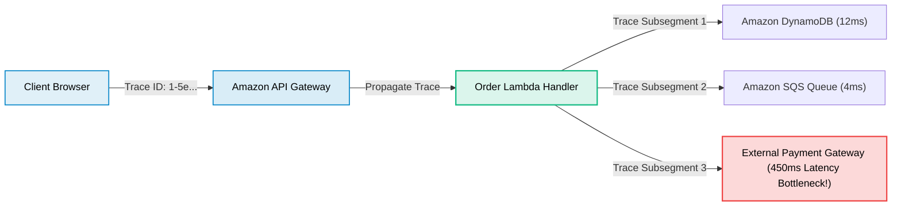

# AWS X-Ray (Distributed Tracing)

> **Focus**: End-to-end request tracing across distributed microservices, service maps, and latency debugging.

---

## 1. Distributed Trace & Service Map

X-Ray propagates a trace header (`X-Amzn-Trace-Id`) across service boundaries to construct a unified latency graph.

---

## 2. Trace Anatomy: Segments vs. Subsegments

- **Segment**: Represents work done by a compute resource (e.g., the Lambda function invocation or EC2 web server).
- **Subsegment**: Breaks down internal downstream operations within that segment (e.g., an outbound SQL query, HTTP call, or S3 read).
