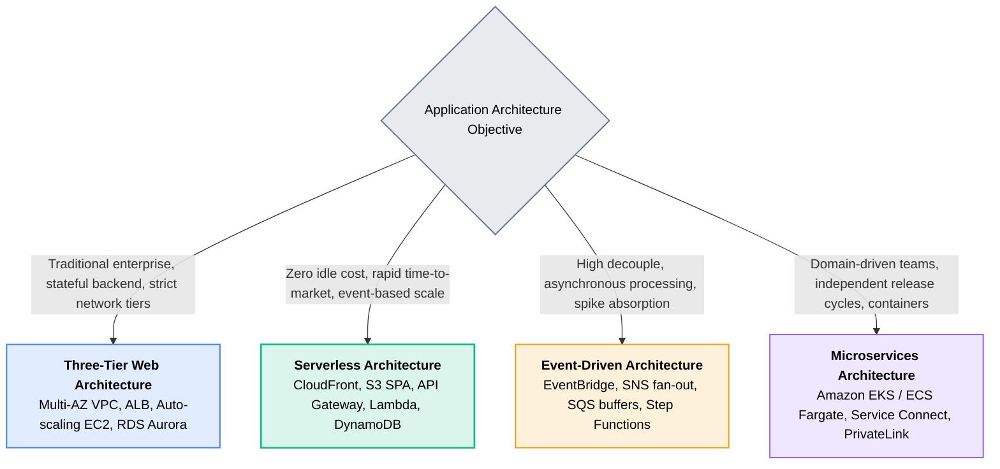

# 09 · Production Architecture Patterns

> **Module**: Architecture Patterns  
> **Focus**: Reference architectures, Well-Architected Framework principles, and trade-off analyses.

---

## Pattern Comparison Matrix

---

## Architecture Patterns Directory Index

- **[[three-tier-architecture/README|Three-Tier Architecture]]** — Classic enterprise Web-App-Database multi-AZ design.
- **[[serverless-architecture/README|Serverless Architecture]]** — 100% serverless web and API pattern.
- **[[event-driven-architecture/README|Event-Driven Architecture]]** — Asynchronous choreography and event-sourced workflows.
- **[[microservices-architecture/README|Microservices Architecture]]** — Containerized domain microservices with decentralized data.
