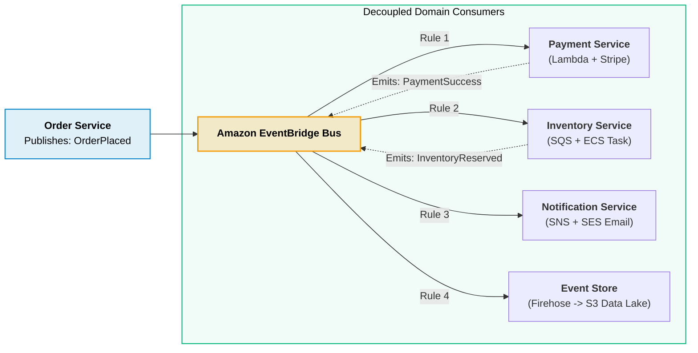
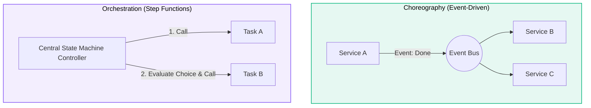

# Event-Driven Architecture (EDA) Pattern

> **Focus**: Asynchronous event choreography, decoupled microservices, and resilient spike leveling.

---

## 1. Choreographed E-Commerce Event Workflow

---

## 2. Choreography vs. Orchestration

