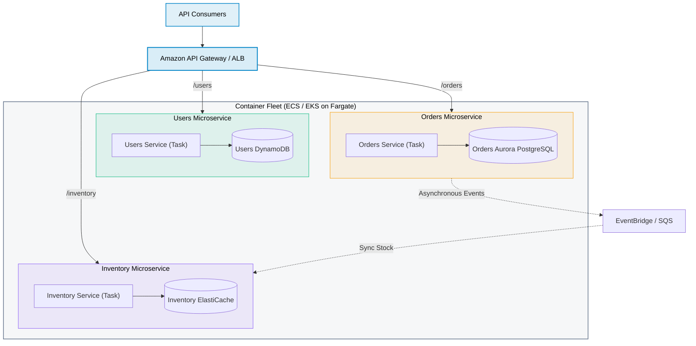

# Microservices Architecture Pattern

> **Focus**: Bounded contexts, independent scaling, service discovery, and database-per-service isolation.

---

## 1. Modern Microservices Architecture on AWS

---

## 2. Microservice Isolation Golden Rules

- **Database-per-Service**: Never allow Microservice A to query Microservice B's database directly.
- **API or Event Contracts**: Communication between domains must occur strictly via public REST APIs or asynchronous event schemas.
