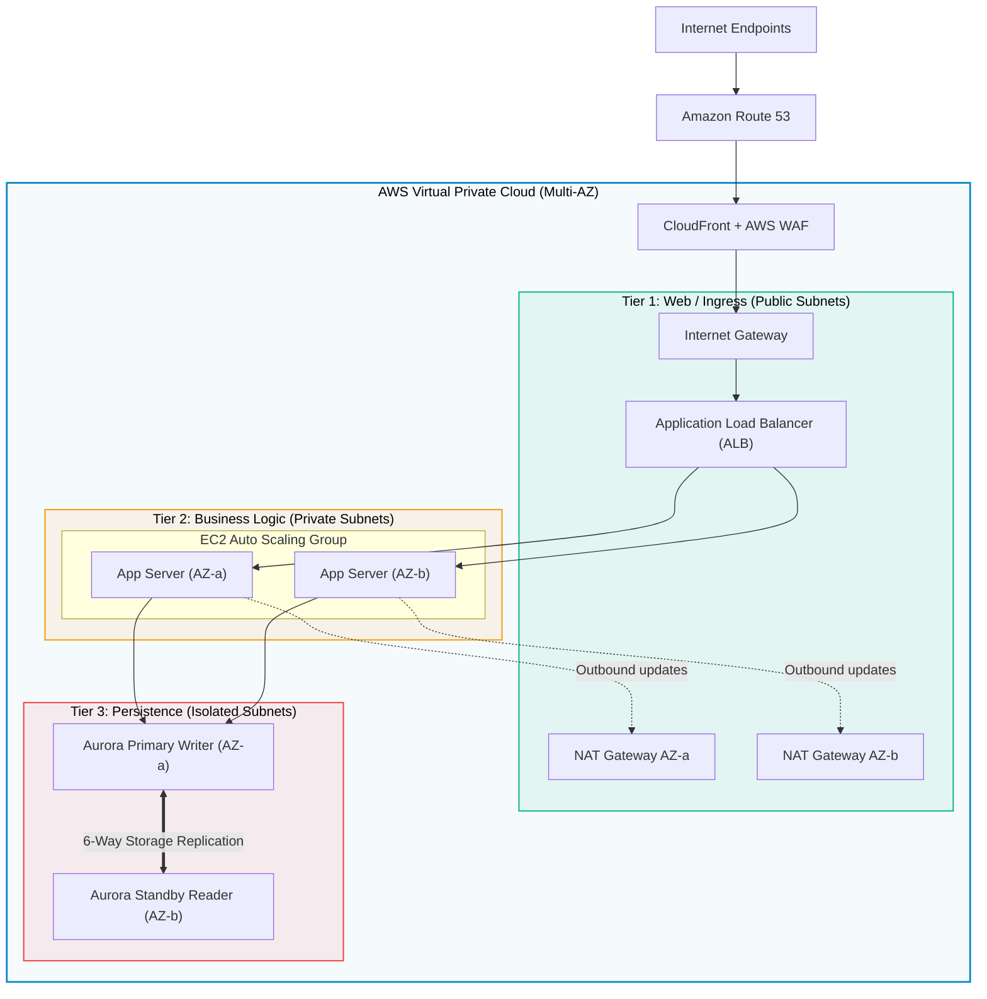

# Three-Tier Web Architecture Pattern

> **Focus**: Multi-AZ high availability, subnet tier isolation, and defense-in-depth networking.

---

## 1. Multi-AZ 3-Tier Architecture Blueprint

---

## 2. Key Architecture Principles

- **Zero Public IPs in App/DB Tier**: Instances in Tiers 2 & 3 have private IP addresses only.
- **Strict Security Group Chaining**: Tier 2 SG allows ingress *only* from Tier 1 ALB SG; Tier 3 SG allows ingress *only* from Tier 2 App SG.
