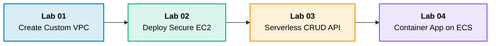

# 10 · AWS Hands-On Labs

> **Module**: Practical Labs  
> **Focus**: Step-by-step implementation playbooks with commands and architecture blueprints.

---

## Guided Labs Learning Path

---

## Labs Directory Index

- **[[create-vpc/README|Create Custom VPC]]** — Multi-AZ VPC with Public/Private subnets, IGW, and NAT.
- **[[deploy-ec2/README|Deploy EC2 Web Server]]** — Launch Linux instance with automated User Data and Security Groups.
- **[[deploy-serverless-api/README|Deploy Serverless API]]** — Build a scalable CRUD API with API Gateway, Lambda, and DynamoDB.
- **[[deploy-container-application/README|Deploy Container App]]** — Package Docker app, push to ECR, and launch on ECS Fargate behind ALB.
