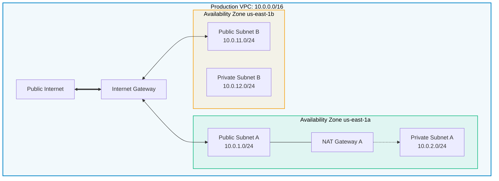

# Lab 01 · Build a Production Multi-AZ VPC

> **Objective**: Provision a 2-AZ VPC containing Public & Private Subnets, an Internet Gateway, a NAT Gateway, and dedicated Route Tables.

---

## Target Architecture



---

## Execution Steps

```bash
# 1. Create VPC
VPC_ID=$(aws ec2 create-vpc --cidr-block 10.0.0.0/16 --query 'Vpc.VpcId' --output text)

# 2. Create Internet Gateway & Attach
IGW_ID=$(aws ec2 create-internet-gateway --query 'InternetGateway.InternetGatewayId' --output text)
aws ec2 attach-internet-gateway --vpc-id $VPC_ID --internet-gateway-id $IGW_ID

# 3. Create Public Subnet in us-east-1a
PUB_SUB=$(aws ec2 create-subnet --vpc-id $VPC_ID --cidr-block 10.0.1.0/24 --availability-zone us-east-1a --query 'Subnet.SubnetId' --output text)

# 4. Create Public Route Table & Default Route
RT_PUB=$(aws ec2 create-route-table --vpc-id $VPC_ID --query 'RouteTable.RouteTableId' --output text)
aws ec2 create-route --route-table-id $RT_PUB --destination-cidr-block 0.0.0.0/0 --gateway-id $IGW_ID
aws ec2 associate-route-table --subnet-id $PUB_SUB --route-table-id $RT_PUB
```
