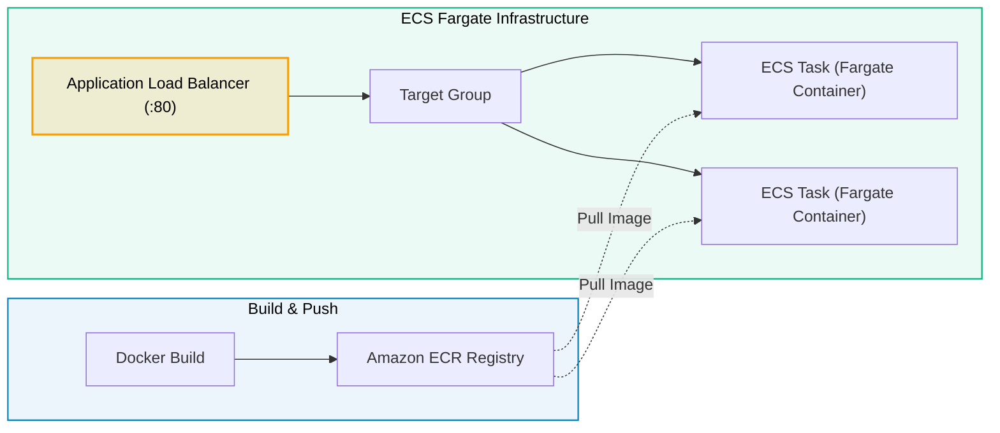

# Lab 04 · Deploy a Container Application on ECS Fargate

> **Objective**: Build a Docker image, push it to Amazon ECR, and deploy it to an Amazon ECS Fargate cluster with an Application Load Balancer.

---

## Target Deployment Pipeline & Architecture



---

## Deployment Steps

```bash
# 1. Create ECR Repo & Authenticate
aws ecr create-repository --repository-name my-app
aws ecr get-login-password | docker login --username AWS --password-stdin <aws-account-id>.dkr.ecr.us-east-1.amazonaws.com

# 2. Build & Push Image
docker build -t my-app .
docker tag my-app:latest <aws-account-id>.dkr.ecr.us-east-1.amazonaws.com/my-app:latest
docker push <aws-account-id>.dkr.ecr.us-east-1.amazonaws.com/my-app:latest

# 3. Create ECS Cluster & Deploy Fargate Service
aws ecs create-cluster --cluster-name production-cluster
aws ecs create-service --cluster production-cluster --service-name app-service \
  --task-definition my-app-task:1 --desired-count 2 --launch-type FARGATE \
  --network-configuration "awsvpcConfiguration={subnets=[subnet-1,subnet-2],securityGroups=[sg-1],assignPublicIp=ENABLED}"
```
