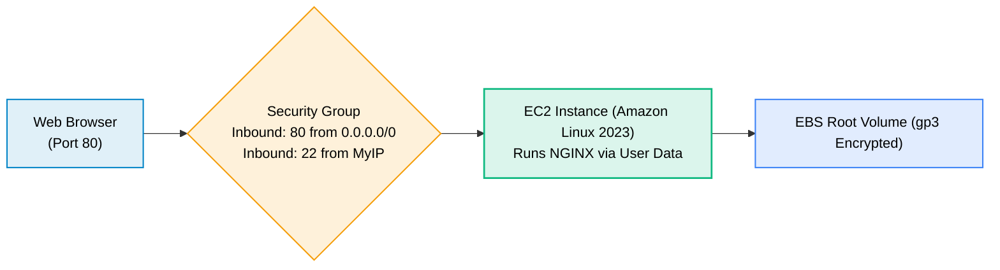

# Lab 02 · Deploy an EC2 Web Server

> **Objective**: Launch an Amazon Linux 2023 EC2 instance with automated User Data bootstrapping, Security Group rules, and public HTTP verification.

---

## Target Architecture



---

## User Data Boot Script (`userdata.sh`)

```bash
#!/bin/bash
dnf update -y
dnf install -y nginx
systemctl start nginx
systemctl enable nginx
echo "<h1>Deployed via AWS EC2 User Data</h1>" > /usr/share/nginx/html/index.html
```

---

## CLI Deployment Command

```bash
aws ec2 run-instances \
  --image-id ami-0c101f26f147fa7fd \
  --instance-type t3.micro \
  --security-group-ids sg-0123456789abcdef0 \
  --subnet-id subnet-0123456789abcdef0 \
  --user-data file://userdata.sh \
  --tag-specifications 'ResourceType=instance,Tags=[{Key=Name,Value=web-server-demo}]'
```
