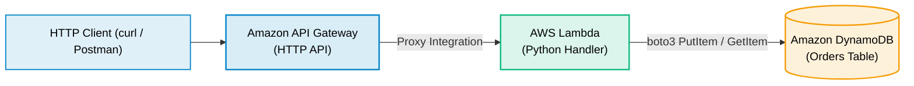

# Lab 03 · Deploy a Serverless CRUD API

> **Objective**: Build an end-to-end serverless REST API using API Gateway (HTTP API), AWS Lambda (Python), and Amazon DynamoDB.

---

## Architecture Flow



---

## Lambda Handler Code (`lambda_function.py`)

```python
import json
import boto3
import os

dynamodb = boto3.resource('dynamodb')
table = dynamodb.Table(os.environ.get('TABLE_NAME', 'Orders'))

def handler(event, context):
    method = event.get('requestContext', {}).get('http', {}).get('method', 'GET')
    
    if method == 'POST':
        body = json.loads(event.get('body', '{}'))
        table.put_item(Item={'order_id': body['order_id'], 'amount': body['amount']})
        return {'statusCode': 201, 'body': json.dumps({'message': 'Order created'})}
    
    return {'statusCode': 200, 'body': json.dumps({'status': 'Serverless API healthy'})}
```
