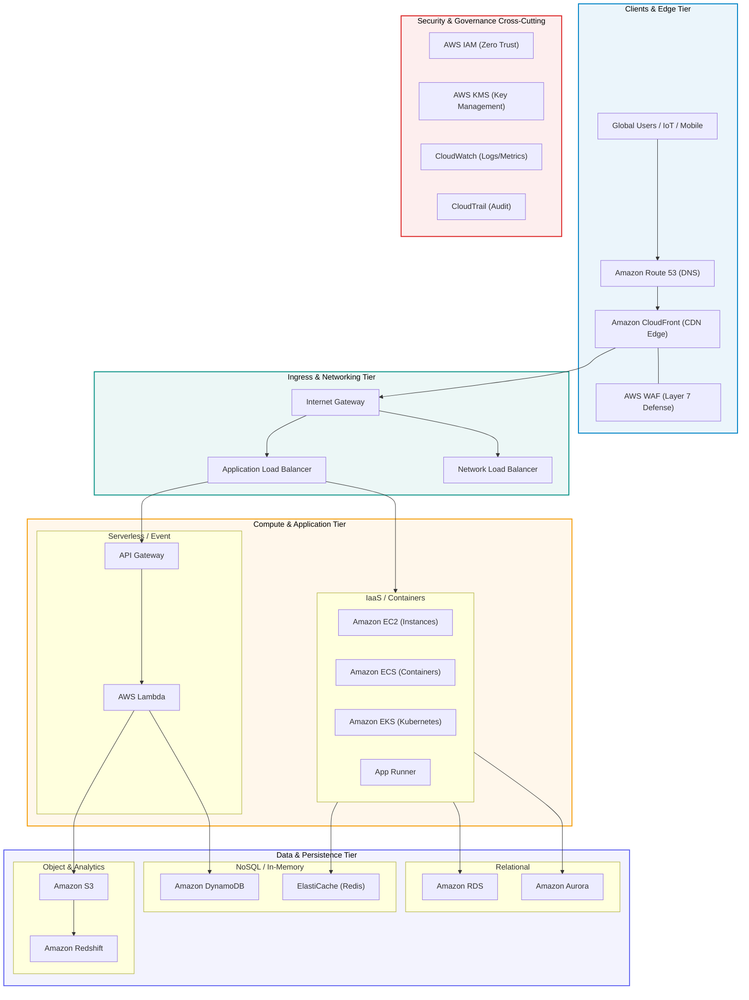

# AWS Cloud Engineering Handbook

> **Path**: `02-cloud-providers/aws/`  
> **Target Audience**: Cloud Engineers, Solutions Architects, DevOps Practitioners  
> **Format**: Concise architectural summaries with high-density Mermaid visuals

---

## AWS Global Architecture Landscape

AWS infrastructure is organized into hierarchical compute, storage, networking, database, security, and integration layers connected by an ultra-low-latency private fiber backbone.

---

## Modular Curriculum Index

| Module | Title | Core Focus Areas |
| :--- | :--- | :--- |
| **[[00-introduction/README\|00 · Introduction]]** | Foundations | Global infrastructure, Multi-account AWS Organizations, Pricing |
| **[[01-compute/README\|01 · Compute]]** | Processing | EC2, Lambda, ECS, EKS, AWS App Runner |
| **[[02-storage/README\|02 · Storage]]** | Persistence | S3 Object, EBS Block, EFS File System, S3 Glacier Archive |
| **[[03-networking/README\|03 · Networking]]** | Connectivity | VPC, Subnets, Routing, IGW, NAT GW, ALB/NLB, CloudFront, Route 53 |
| **[[04-databases/README\|04 · Databases]]** | Data Engines | RDS, Aurora, DynamoDB NoSQL, ElastiCache In-Memory, Redshift OLAP |
| **[[05-security/README\|05 · Security]]** | Hardening & Auth | IAM RBAC/ABAC, KMS Encryption, Secrets Manager, Security Groups, WAF |
| **[[06-integration/README\|06 · Integration]]** | Decoupling | SQS Queues, SNS Pub/Sub, EventBridge Bus, Step Functions, API Gateway |
| **[[07-devops/README\|07 · DevOps & IaC]]** | Automation | AWS CDK, CloudFormation Stacks, CodePipeline CI/CD, CodeBuild |
| **[[08-monitoring/README\|08 · Monitoring]]** | Observability | CloudWatch Metrics/Logs, CloudTrail Auditing, X-Ray Distributed Tracing |
| **[[09-architecture-patterns/README\|09 · Architecture Patterns]]** | Blueprints | 3-Tier Enterprise, Serverless, Event-Driven, Microservices |
| **[[10-hands-on-labs/README\|10 · Hands-On Labs]]** | Implementation | Real-world guided implementations from scratch |
